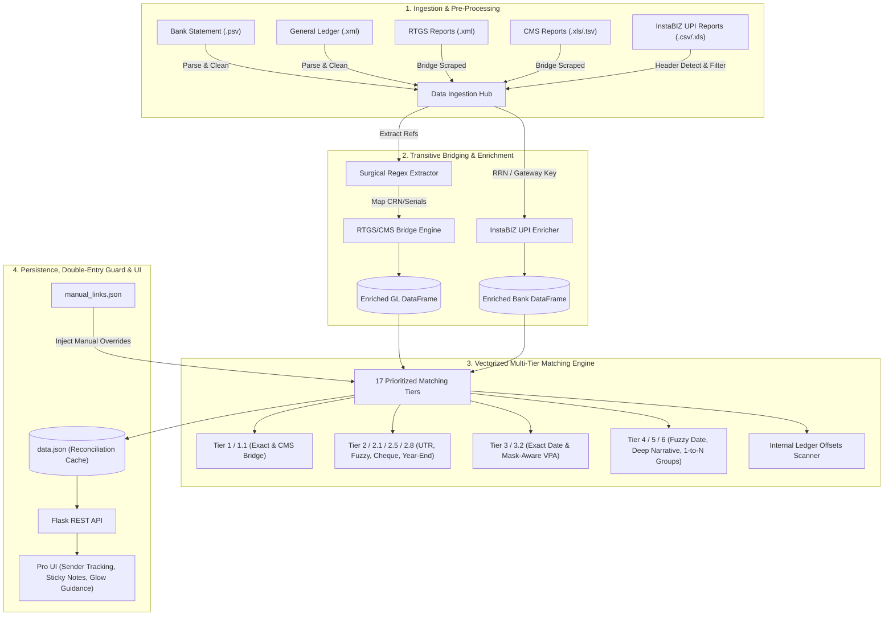

# 🌌 ICICI-GL Reconciliation Engine: Core Logic & Architecture

Welcome to the technical blueprint of the **ICICI-GL Reconciliation Engine (Pro Edition)**. This high-performance engine is designed for surgical precision and low-latency matching, handling 90,000+ complex transactions, unstructured banking narrations, UPI VPA mask resolution, and multi-layered reference bridging.

---

## 🛠️ 1. High-Level System Architecture

The engine uses a modular **Data-Pipe Architecture** consisting of five specialized stages: Ingestion & Enrichment, Transitive Bridging, Mask-Aware UPI Resolution, Vectorized Tiered Matching, and Double-Entry Persistence.



---

## 🔍 2. Surgical Reference Ingestion & Extraction

Before any matches are compared, the ingestion pipeline cleans and extracts references from unstructured narrations using an anchored Regex engine with strict digit boundary guards.

### Anchored 12-Digit UTR Guard
```python
# Guarded against concatenated digits and scientific notation
REGEX_12DIGIT = re.compile(r'(?<!\d)\d{12}(?!\d)')
```
- **Digit Boundary Guards**: `(?<!\d)\d{12}(?!\d)` prevents false extractions from longer account numbers, timestamps, or phone numbers.
- **Cheque Sequences**: Supports `_`, `#`, `-`, and CTS clearing markers for 6-to-10 digit cheque numbers.
- **Indic Phonetic Normalization**: Normalizes Malayalam/Indian transliteration variations (`th/t`, `sh/s`, `ee/i`, `oo/u`) to prevent narrative false negatives.

---

## 🌉 3. The Transitive Bridge Mechanism (Solving the Reference Gap)

In enterprise accounting, a GL transaction is frequently logged using an internal Payment Serial Number, whereas the bank statement records the transaction with a Global UTR. They share no direct text alignment. The engine bridges this gap by cross-referencing auxiliary reports:

```
       [ General Ledger Entry ]
                  │
                  ▼ (Has Serial No: 270326100418)
    ┌───────────────────────────┐
    │  A. RTGS XML Outward Rep  │ ───► Maps Serial 270326100418 to CRN: CMS5605778710
    └───────────────────────────┘
                  │
                  ▼ (Matched via CRN)
    ┌───────────────────────────┐
    │   B. CMS Excel Report     │ ───► Maps CRN to Customer Ref: 914549257
    └───────────────────────────┘
                  │
                  ▼ (Bridge Enriches GL Row's References)
        [ Enriched GL References ] ◄─── Contains [270326100418, 914549257]
                  │
                  ├───► [ Perfect Match via Overlapping Ref '914549257'! ]
                  │
        [ Bank Narration Row ] ◄────── Contains CMS/001914073925/914549257
```

- **Inward RTGS CBS Bridging**: For inward remittances lacking outward batch serials, the engine cross-references Inward RTGS reports by `(TO_CBS_ACCNO, amount, date)` tuple to link the bank statement entry directly to the GL account.

---

## 💳 4. Multi-Schema UPI Engine & InstaBIZ Mask-Aware Ingestion

To address the September 2026 NPCI UPI VPA masking mandate (enforced under the Digital Personal Data Protection Act 2023), the engine incorporates a multi-schema parser and automated InstaBIZ collection report ingestion.

### 1. Multi-Schema UPI Parser (`parse_upi_narration`)
Standard ICICI UPI narrations follow a 6-part schema, but remitter banks often send extended 7-part schemas where the payer name precedes the VPA:
- **7-Part Remitter Schema**: `UPI / <Payer Name> / <VPA Handle> / <Marker> / <Remitter Bank> / <12-Digit UTR> / <Gateway Ref>`
- **6-Part ICICI Schema**: `UPI / <12-Digit UTR> / <Remark> / <VPA Handle> / <Remitter Bank> / <Gateway Ref>`
- **Bank Noise Shield**: Strictly excludes bank tokens (`PUNJAB`, `STATE BANK`, `CANARA`, `IDFC`, `FEDERAL`, `UNION`, etc.) from polluting VPA or party fields.

### 2. InstaBIZ Collection Report Ingestion (`load_upi_collection_reports`)
- Scans `Data/<FY>/UPI Collection Report/` for CSV, TSV, XLS, and XLSX exports.
- Dynamically locates table headers (`BANK RRN`, `CUSTOMER VPA`, `PAYER NAME`, `TRANSACTION AMOUNT`, `TRANSACTION STATUS`).
- Filters for successful transactions (`Transaction Status == Success`), safely discarding failed or declined entries.
- Enriches both Bank and GL records with unmasked `Customer VPA` and official `Payer Name` via 12-digit RRN and gateway switch tokens.

### 3. Mask-Aware VPA Matching Engine (`vpa_matches`)
Enables asymmetric matching between unmasked VPAs and masked `XX...` handles when PSP domains match and the unmasked handle ends with the masked tail (tail $\ge 3$ characters):
```python
def vpa_matches(v1: Optional[str], v2: Optional[str]) -> bool:
    # Handles exact matches and asymmetric masked matches
    # e.g., 'SABITHATLY2000@OKSBI' matches 'XX2000@OKSBI'
    ...
```

---

## 📊 5. Deep-Dive Prioritized Matching Tiers Catalog

The engine processes data through a sequence of prioritized filters (order below = execution order). Once a transaction is reconciled in a tier, it is removed from the search pool.

| Tier | Status | Window / Tolerances | Rules |
| :--- | :--- | :--- | :--- |
| **Tier 0** | `MANUAL_MATCH` | — | User-verified links from `manual_links.json` (checked against the contra account). N-to-N. |
| **GST bundle** | `BUNDLED_GST_MATCH` | ±15 days | Bank charge + SGST/CGST sub-rows (same base id) vs compatible GL rows. |
| **Tier 1** | `TIER1_PERFECT` | Same date, exact amount | Shared reference/UTR (or edit-distance-1 UTR). Sign-sensitive. |
| **Tier 1.1** | `TIER1.1_TRANSITIVE_CMS` | Same date, exact amount | Shared ref only reachable via the RTGS/CMS bridge. Bypasses the Hard Conflict Guard. |
| **Tier 2** | `TIER2_UTR_MATCH` | ±45 days, exact amount | Shared reference/UTR. |
| **Tier 2.5** | `TIER2.5_CHEQUE_MATCH` | ±3 days, exact amount | Identical cheque number. |
| **Tier 2.1** | `TIER2.1_FUZZY_UTR` | ±3 days, exact amount | Levenshtein ≤1 between an 11–13 digit GL ref and a bank UTR (incl. prefix-glued `UPI8630755138261`). |
| **Tier 2.6** | `TIER2.6_INTER_BRANCH_CLEARING` | ±3 days, exact amount | KOD/PKT/KTH branch code or compatible narration. |
| **Tier 2.8** | `TIER2.8_YEAR_END_CLEANUP` | Any (GL dated 28–31 Mar) | Shared reference. |
| **Tier 2.2** | `TIER2.2_LATE_UTR_MATCH` | **Any gap**, exact amount | Exact 12-digit UTR that occurs exactly once on each side. `LATE MATCH` badge. |
| **Tier 3** | `TIER3_EXACT_DATE` | ±1 day, ±₹0.50 | Compatible narration, or (exact amount) GL carries the UTR's last 5–6 digits. |
| **Tier 3.2** | `TIER3.2_UPI_VPA_MATCH` | ±5 days, exact amount | Same or mask-resolved VPA. |
| **Tier 3.3** | `TIER3.3_RTGS_IFSC_MATCH` | ±1 day, exact amount | Bank `RTGS-/NEFT-<IFSC4>…` whose bank is named in an RTGS/NEFT GL line; unique candidate only. |
| **Tier 3.4** | `TIER3.4_STATUTORY_MATCH` | ≤31 days, exact amount | Same statutory class (GST/PF/ESI/TDS); bank side must be a `GIB/` tax payment; nearest date wins. |
| **Tier 3.5** | `TIER3.5_ONACHANTHA_SALES_MATCH` | ±7 days (Aug–Sep) | Festival-stall keywords. |
| **Tier 4** | `TIER4_FUZZY_WINDOW` | ±5 days, ±₹0.50 | Compatible narration. |
| **Tier 4.5** | `TIER4.5_MAR_MAY_SUSPENSE_BRIDGE` | Mar 31 ↔ late May | SL-758 suspense + reversal vs bank. |
| **Tier 5** | `TIER5_DEEP_NARRATION` | ±15 days, exact amount | Compatible narration or SequenceMatcher > 0.72 (UTR conflict guarded). |
| **Tier 5.5** | `TIER5.5_COOP_SEMANTIC_RECOVERY` | ±15 days | Malayalam re-pledge / missed-installment triggers. |
| **Tier 6** | `TIER6_ONE_TO_MANY` | ±3 days | One bank row = sum of same-narration GL rows. |
| **Tier 6b** | `TIER6B_MANY_TO_ONE` | ±3 days | Many bank rows = one GL row. |
| **Offsets** | `INTERNAL_OFFSET_GL` / `_BANK` | ±45 days | Debit/credit pairs inside one ledger (FAILED/REVERSAL/RETURNED normalized). |

**Never auto-matched (suggestion + flag only):** re-sent payments (double-transfer groups), same UTR with a different amount, and rows whose narration is a copied/double-posted voucher.

---

## 🛡️ 6. Hard Conflict Guard with Transitive Exception

To prevent false auto-links, a **Hard Conflict Guard** checks all candidate matches in the vectorized UTR loops:
- **Conflict Guard Rule**: If a GL entry has a 12-digit reference and a Bank entry has a different 12-digit reference, they are flagged as a mismatch and blocked.
- **Transitive Exception**: Validated CMS-bridged transactions mathematically expect different 12-digit references (GL payment serial vs. Bank batch ref). When auxiliary reports link the two, the Conflict Guard is safely bypassed.

---

## 🧯 6b. Human-Error & Data-Integrity Safeguards

The GL is keyed by hand and statements are downloaded by hand, so the engine checks its own inputs:

- **Statement integrity** — each `.psv` is replayed through its *Available Balance* column; any row whose balance ≠ previous ± amount marks missing rows. A credits-only export (the Nov-2026 incident: 45 gaps, ₹83.27 lakh of debits missing) or a one-sided file raises a red banner.
- **Double-transfer fail-safe** — CMS payments to the same beneficiary A/c for the same amount within 7 days form a group. Groups where every live leg has its own GL voucher are legitimate repeats and are dropped; failed legs move no money. Remaining groups: `RETRY_PENDING`, `DOUBLE_PAID`, `DOUBLE_DEBITED`, `RETRY_OK`. The bank side is checked by leg reference and, while a leg is still in flight, by beneficiary IFSC (an IMPS whose RRN the CMS report does not know yet).
- **Copied / double-posted narrations** — the transaction's own reference (`primary_txn_ref`: UPI UTR, IMPS RRN, RTGS `Ref No`; never account numbers or phone digits) re-appearing on a later GL date ⇒ `DOUBLE POSTED?` (same amount) or `COPIED NARRATION`.
- **Sticky-note corrections** — `Correct = …` / `Missing narration - …` text in a note contributes its UTRs to matching.

## 🏛️ 7. Core Accounting, Persistence & Double-Entry Guards

Reconciliation state changes are strictly governed by double-entry ledger constraints:
- **Sign Sensitivity**: Bank DEBIT (Cash Outflow) matches GL CREDIT (Asset Reduction); Bank CREDIT (Cash Inflow) matches GL DEBIT (Asset Increase).
- **Double-Entry Manual Unlink Guard**: The unlinking API enforces structural validation. Any partial unlink that leaves orphaned links is completely dissolved, preventing unbalanced ledger states.
- **Atomic File Storage (`storage.py`)**: All saves use PID/TID-tagged temporary files (`path.pid.tid.tmp`), atomic replace, and Windows exponential backoff retries. Corrupt active files are automatically recovered from verified `.bak` backups.
- **Persistent UPI Knowledge Base (`Data/upi_knowledge_base.json`)**: Persistent cross-FY database mapping customer UPI handles to verified payer names and transaction counts.
- **Enterprise Sticky Notes System**: 7 note types (`NOTE`, `WARNING`, `ACTION`, `AUDIT`, `TAX`, `QUERY`, `WRONG_NARRATION`), severity scoring (`critical` to `info`), open/resolved lifecycle tracking, and bulk annotation via `POST /api/sticky-notes/batch`.

---

*Last Audit Date: November 12, 2026*  
*Audit Status: Full-app audit (data integrity, human-error safeguards, tags, UI). 69/69 tests pass.*
